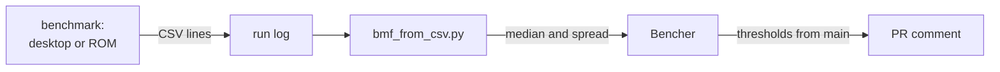

For two weeks the Mega Drive stood on the edge of the repair bench: I had to finish its standard library. I'm writing ToyGine2, an engine for small games that should run on modern machines and on retro hardware. The cycle went into strings: making them build on the Mega Drive, behave like the standard ones, and making their speed measurable.

<!-- truncate -->

[In short](#short) · [The Mega Drive without a libc](#md-libc) · [StringView against std::string_view](#string-view) · [Benchmarks for the consoles](#benchmarks) · [Numbers](#numbers) · [What's next](#next)

## In short {#short}

`StringView` got search, comparison and UTF-8 character counting, and all of it builds on the Mega Drive, which needed the missing part of its libc written. A brute-force check against `std::string_view` found 27 mismatches and one crash, and now there are none. The engine got nanobench benchmarks and a pipeline that sends the results to Bencher, and the consoles have their own benchmark runner with no floating point in the works. All of this went into version 26.19.0, and [the release is on GitHub](https://github.com/ToymanInteractive/toygine2/releases/tag/26.19.0).

- `CStringView` was renamed to `StringView`. `toy::utf8Len()` counts UTF-8 characters, and `toy::validateUtf8()` checks a string against table 3-7 of the Unicode standard.
- The assertion handler returns `true` when execution should stop, like Microsoft's `_CrtDbgReport`. In tests, handlers no longer throw out of a `noexcept` function, which used to kill the whole test binary.
- The built-in test runner prints results in TAP 14, a text protocol for tests.
- `application::Version` with comparison, `log::Level` with a `LOG_MAX_LEVEL` ceiling and `log::Metadata` appeared, and `FixedStringStorage` and the `StringStorage` concept laid the base for a future heap-free string.
- ckdl and the Vulkan headers live in `thirdparty/`, and the editor made it into the CI artifacts.
- macOS builds get `-O2`, `-g` and `NDEBUG` again: empty flag variables had been silently overriding them.

## The Mega Drive without a libc {#md-libc}

The Mega Drive build in CI failed on `#include <cstring>`. The header from ClownMDSDK, the development kit for this console, didn't compile at all: it had an unqualified `using memcpy;`. Working around it with a `::strncpy` call didn't help either: the SDK had no `strncpy` at all, neither a declaration nor an implementation.

Then it turned out that the SDK's `libc.a` was a 1824-byte stub. It held exactly three functions, `memcpy`, `memmove` and `memset`, the ones GCC emits calls to by itself. There was no `memcmp`, `memchr` or `strlen`, which `std::char_traits<char>` relies on, and `StringView` relies on that in turn.

The fix went into the engine repository, on top of the installed SDK. It's an overlay: my own `string.h` and `cstring`, which come earlier in the search path than the SDK's, and my own `string.c`, compiled into the engine library. No platform `#ifdef`s were added to the code: the seam runs along file boundaries. I checked in the map file that the override holds at link time too: `memcpy` and `strncpy` come from the engine library, and `libc.a` is loaded but doesn't contribute a single member.

I checked every new function against the system libc by brute force over all short strings, lengths and character values, and found no differences. Upstream had a worse bug than the missing functions: `cstdlib` carried the include guard from `cstring`, so after `<cstring>` the `<cstdlib>` header silently dropped out entirely. The fixes live in my fork of the SDK; I haven't opened an upstream PR yet.

I made one mistake myself: I set the overlay to `-std=gnu17` for the sake of `asm` blocks in `string.c` that weren't there then and never were. I dropped the flag, the overlay builds with `-std=c17`, and the ROM came out the same size.

A kit for a console with no operating system promises less than its header names suggest: `cstring` in the SDK tree doesn't mean anyone ever included it. For someone writing a game for the Mega Drive, this is what changed: the string functions the engine relies on work, and its code written for the desktop builds there without platform branches.

## StringView against std::string_view {#string-view}

`StringView` is a view over a null-terminated string. It's a relative of `std::string_view` that also guarantees `c_str()`. This cycle it got `compare`, `starts_with` and the whole search family: `find`, `rfind`, `find_first_of` and their neighbours, each with four overloads. Its behaviour has to match the standard one to the byte, and tests on hand-picked examples don't prove that.

The red phase found the first bug before any cross-checking. All nine overloads of the reverse search defaulted to `pos = 0`, while in a reverse search `pos` is an upper bound for where a match starts. With zero, `rfind("abra")` only found a match at the very start of the string. The default is now `npos`, as in the standard.

Then I wrote a differential harness: the same inputs go into `toy::StringView` and `std::string_view`, and the results are compared. A cartridge dump is verified the same way: the ROM you read off is compared byte for byte with a reference dump, and a mismatched byte shows up at once, without working out what the game does. The first search run, over all strings up to four characters long from the alphabet `{a, b, c}` and every position, found no mismatches.

I built the second run without `_DEBUG`, that is, with assertions off, and added positional `compare` calls with counts all the way up to `npos`. It found 27 mismatches and crashed. The minimal case is `a.compare(0, npos, b, 0, npos)`: the second count wasn't clamped to the length, and `SIZE_MAX` bytes went into `memcmp`. Of the 27 mismatches, 19 came from the five-argument overload: with two empty parts and different counts it declared the left side smaller. The counts are now clamped to the length, as in the standard, and there are no mismatches. A run over the rest of the API under ASan and UBSan is clean too.

I checked the tests themselves with mutations: break a method and see whether the suite notices. On the iterators the suite caught eight breakages out of eight; on search, three slipped through. One of them involved a character with the high bit set: none of the 122 tests ran one through a set search. Each got a case of its own.

A harness checks exactly what it lists: the first run was clean because it never reached `npos` in the counts. For someone writing a game, search and comparison in `StringView` give the same answers as the standard ones, including on empty strings and on `npos`.

## Benchmarks for the consoles {#benchmarks}

Search in `StringView` worked correctly, but I knew nothing about its speed: the `benchmarks/` directory held not a single benchmark. I needed to measure on the desktop and on the consoles, and nanobench won't build there: it needs a host clock, iostreams and floating point, and the 68000 and the ARM7 have none of that.

I started with nanobench on the desktop. I took the first numbers from a debug build with no `-O` at all: the same change gave a 14x speedup there and 8x in release. Since then the rule is written down: measure release only.

The measurements paid off at once. `find` switched to finding the first character through `traits_type::find` and went from 405 to 55.7 ns. For `rfind` I almost ported the libc++ strategy, which scans forward and remembers the last match. One case showed the cost. With the needle at the very end of a four-kilobyte text, the backward scan answered at once at 4.08 ns, while libc++'s forward scan crossed the whole text and took 992 ns. The backward scan stayed, and I made each position cheaper by checking the needle's first and last byte.

On the desktop nanobench prints a table, while the console runner prints CSV lines with integers: timer ticks and call counts. A script on the CI host computes the median and spread and builds the report for Bencher. Later I tightened the format: the case and table row names are written once instead of in every epoch. I picked 7 epochs rather than 11, and not for statistical reasons: a line of the mGBA debug log is cut at 256 bytes, and with 11 epochs the worst line doesn't fit.

The clocks differ from console to console. On the GBA it's Timer 2 with no prescaler, cascading into Timer 3 so the 16-bit counter doesn't overflow within an epoch. On the Mega Drive it's the frame counter plus the video chip's line counter. The `sink = &value` optimizer barrier didn't work: AppleClang, `m68k-elf-gcc` and `arm-none-eabi-gcc` removed the computation entirely. It was replaced by `asm volatile("" : : "r,m"(value) : "memory")`: there's no instruction in it, but `value` is passed as an input operand, so the compiler has to compute it.

One oddity I never explained: for four builds in a row, the `compare` measurement moved from 3.99 to 26.48 ns depending only on which cases were in the binary, and on the fifth the effect was gone. I ruled out CPU load and stack alignment. Until I find the cause, I compare numbers only within one table from one build, where the `std` row serves as the control.

A character table for find_*_of: built and rolled back

A 256-bit mask instead of rescanning the set for every byte made `find_first_of` and its neighbours 3.7 to 4.3 times faster, and 3 to 6 times faster than `std`. I had no way to check it on the consoles, and there it's expensive: on the 68000 a variable shift costs 8 + 2n cycles for every byte. I rolled it back entirely and will return to it once the console runner works.

A number without its build conditions means nothing: a debug build lies, neighbouring cases interfere, and only the `std` row next to it keeps a measurement honest. For someone writing a game, the engine now has a way to find out what a call costs, and the same `*.benchmark.cpp` will later go to the GBA and the Mega Drive.

The engineer with the Spectrum came by and asked how many cycles a string search takes. On the desktop I now know it in nanoseconds. Cycles on the 68000 will come once the console runner works in an emulator.

<!--
ДЛЯ ЧЕЛОВЕКА: кадр темы про бенчмарки. С первого взгляда должно читаться,
что на портативной приставке что-то замеряют несколько раз подряд и
записывают каждый замер. Пропорции 16:9, минимум 1600 × 900. Если генерация
не сложится, кадр можно заменить комментарием Bencher в пул-реквесте.

ALT RU: 32-битная портативная приставка рядом с механическим секундомером и листком с семью одинаковыми карандашными засечками
ALT EN: A 32-bit handheld console next to a mechanical stopwatch and a notepad with seven identical pencil tally marks

ДЛЯ AI:
A purple 32-bit handheld console from the early 2000s, wide, with the screen
between a direction pad on the left and two round buttons on the right, two
shoulder buttons on the top edge and a small grey cartridge in the slot in its
back edge, lies switched on in the middle of the repair bench, its screen
showing an abstract pattern of coloured pixel blocks. To its right lies a
chrome mechanical stopwatch with a white dial and plain tick marks, no
numerals. Below them lies a small notepad with seven identical short vertical
pencil tally marks in a single row, evenly spaced, and a pencil resting beside
the row. The shopkeeper's hand holds the stopwatch, thumb on the button. Seen
from above at a slight angle, the console, the stopwatch and the seven marks
form a loose triangle at the centre of the frame, lit warmly from the left.

REFERENCE: draw the console exactly as in this photo:
  https://upload.wikimedia.org/wikipedia/commons/0/0b/Nintendo-Game-Boy-Advance-Purple-FL.png
  (assembled). Keep its shape, proportions, colour and the layout of its
  slots, buttons and ports, redrawn in the illustration style below; leave out
  every logo, brand mark and piece of lettering the photos show.

FORMAT: 16:9 aspect ratio, at least 1600 x 900 pixels, white border included.
CAPTION: "32-bit handheld console, 6th generation, September 2026"

STYLE (identical across all images, so the set reads as one series):
  a hand-painted illustration in the style of Studio Ghibli films:
  watercolour-like painted backgrounds, soft cel shading, clean
  confident linework and warm diffuse shadows. It must read at once as
  a drawing, not a photograph. The illustration is presented as a
  colour print from a late 1980s or 1990s family photo album: a glossy
  paper print with a plain white border on all four sides. The image is
  the scanned print itself: the white border runs to the edges of the
  image, with no table, album page or background around it. Inside the
  border is a cosy, cluttered-but-ordered retro game shop in the spirit
  of the antique shop in Whisper of the Heart, where every object has
  its place: wooden shelves of boxed games, cartridges and cassettes,
  old consoles and home computers, a repair bench at the back. Game
  consoles, computers and media are drawn true to the shape and colour
  described in the scene above, recognisable by form alone, with no
  lettering or logos on their shells. The only writing anywhere is the CAPTION text, handwritten in
  blue ballpoint ink in small neat letters on the bottom white border,
  left of centre. Unless the scene above states otherwise, the only
  person in frame is the shopkeeper, seen from behind or as hands at
  the repair bench: a knitted cardigan over a plain shirt, sleeves
  pushed up.
PALETTE: faded warm print colours: walnut wood, beige and grey console
  plastic, creamy highlights and slightly lifted blacks, with a cool
  teal-green accent from old CRT glow; the white border slightly
  yellowed with age.
LIGHT AND TEXTURE: warm lamplight from one side, soft painted shadows,
  a gentle glow around lamps and the CRT screen, light film grain over
  the whole print, soft vignetting.
NEGATIVE: no legible text, lettering, labels or numerals inside the
  picture, including on screens, cartridges, boxes and console shells;
  no logos, brand marks or watermarks; no real brand or model names
  anywhere; no readable code on screens; no writing on the border
  other than the caption; no torn or ragged
  edges, no album page, table or background around the print; no
  photorealism or photographic rendering of the scene; no 3D render or
  CGI look; no flat vector or modern digital illustration look; no HDR
  or oversaturated colour; no neon or cyberpunk palette; no close-up
  human faces; no clutter that hides the subject.
-->

## Numbers {#numbers}

| What I measured                         | Before                  | After                 |
| --------------------------------------- | ----------------------- | --------------------- |
| `find(s, pos, count)`                   | 405 ns                  | 55.7 ns               |
| `find(char, pos)`                       | 40.4 ns                 | 5.12 ns               |
| `rfind`, 103 bytes, needle at the front | 165.9 ns                | 43.0 ns               |
| `rfind`, 4 KB, needle at the front      | 6,524 ns                | 2,110 ns              |
| Full-run CSV report                     | 287 lines, 22,651 bytes | 27 lines, 6,418 bytes |

Search timings were measured on macOS in release.

## What's next {#next}

The storage and the concept are ready, and the `toy::String` itself will stand on them next. The benchmark bodies will move to the engine's own `Bench`, and the GBA and the Mega Drive will get runners that run them in emulators. A debt remains, too: `_DEBUG` is defined only for MSVC so far, and on every other platform the assertions in a debug build check nothing.
