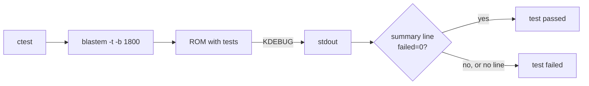

The soldering iron sat in its stand all cycle: I took the Mega Drive off the shelf for tests, not for a repair. I'm writing ToyGine2, an engine for small games that should run on modern machines and on retro hardware. This cycle its tests passed under a Mega Drive emulator for the first time, the string type got assignment, and the build stopped going to the network.

<!-- truncate -->

[In short](#short) · [Tests on the Mega Drive and GBA](#consoles) · [The string that didn't fit](#string) · [Every dependency in the repository](#vendoring) · [Numbers](#numbers) · [What's next](#next)

## In short {#short}

The engine's unit tests now run in CI under a Mega Drive emulator, and on the GBA they run against a free BIOS instead of mGBA's built-in stand-in. `toy::FixedString` got constructors and assignment modelled on `std::basic_string`, and it still never touches the heap. No `FetchContent` is left in the build: every dependency lives in the repository. All of this went into 26.20.0, and [the release is on GitHub](https://github.com/ToymanInteractive/toygine2/releases/tag/26.20.0).

- The MD and GBA toolchain Docker images build on native arm64 GitHub runners instead of under QEMU.
- There is now an N64 toolchain image: libdragon from the `preview` branch with GCC 16.2.
- The engine's two test binaries became one, and the `TOYGINE_TESTS_RUNNER` option picks the runner.
- Benchmarks are written against `toy::benchmark::Bench`: on desktop nanobench sits behind it, and on the consoles it will be a built-in runner.
- Bencher comments on a PR only on an alert, instead of posting seven identical reports.
- The `toy::` re-exports of `std::array`, `std::char_traits`, `std::min` and five other names are gone; call sites use `std::`. This is a breaking change.

## Tests on the Mega Drive and GBA {#consoles}

On the GBA, the engine's tests had been running under mGBA in CI for about a month by then. For the Mega Drive I built the BlastEm emulator into the toolchain Docker image and set up the same kind of run. The CI step kept failing on a timeout, `units-builtin ***Timeout 60.06 sec`, with not a single line of output.

A temporary CI step with `set -x` and `blastem -h` told me little: the `-b` flag, which runs a given number of frames without a window, isn't in the help text. The investigation moved to a local container, where building the ROM and running it takes about a second.

A ladder of frame counts found where it hung. `-b 5` exited at once with code zero, while `-b 60` and `-b 1800` hung until the timeout. So frames were being counted and the emulation was alive, and everything stopped at the point where the runner prints the first line of its report.

The ROM writes report lines to a debug register on the video chip, and BlastEm prints them as `KDEBUG MESSAGE`. Before each of those prints it calls `init_terminal()`. If stdin and stdout aren't a terminal, BlastEm closes the standard streams, forks xterm and waits on a FIFO for it to connect. The CI container has no X server, so xterm never starts, and the process waits forever with stdout already gone. That explained the empty log. The fix is the `-t` flag, which `blastem -h` doesn't list either: I found both flags only in the source.

Once the hang was gone, a second hole showed up. BlastEm always exits with code 0, and the test didn't check its output, so after `-t` it would have passed with any number of failures. The verdict now comes from the text.

The runner prints `# assertions passed=N failed=0` last, so a single regular expression in `PASS_REGULAR_EXPRESSION` catches both failed checks and a run cut off halfway. I tried it on an old ROM with one failing check: the test went red, CTest returned 8 and put the whole report in the log.

The GBA got a full BIOS in the same cycle. mGBA used to stand in for it with its own emulation; now the image carries emibios, a free replacement for the original BIOS. The first run with it dumped 192 lines of `GBA DMA` from the boot animation into the log. The `-C skipBios=1` option skips the animation, while system calls still go through the BIOS code. The price is that CI no longer checks booting through the BIOS.

First hypotheses: a dead 68000 and a broken cartridge header

While the log stayed empty, I suspected the ROM itself: either the CPU wasn't starting or the cartridge header was built wrong. The `-l` flag should have written an address trace, but the file stayed empty because the process was killed before it flushed the buffer. The frame ladder ruled out both hypotheses. A dead CPU wouldn't have made it to a clean exit on frame five.

An emulator in CI is a dependency just like the compiler, and its behaviour without a terminal isn't documented anywhere. I don't trust an emulator's exit code until I have seen the test fail. For someone writing a game on the engine, this is what changed: CI runs 65 test cases and 391 checks on an emulated 68000 and ARM7 for every PR, so a bug that only lives on the 68000 will show up before the merge.

<!--
ДЛЯ ЧЕЛОВЕКА: заглавный кадр темы про тесты на Mega Drive. С первого взгляда
должно читаться, что приставка работает и выводит картинку, но рядом лежит
кабель, который так и не подключили: эмулятор ждал терминала, которого нет.
Пропорции 2:1, минимум 1200 × 630. Если генерация не сложится, кадр можно
заменить схемой прогона ctest и BlastEm из поста.

ALT RU: 16-битная приставка на ремонтном столе соединена с ЭЛТ-экраном, а рядом лежит кабель, который никуда не подключён
ALT EN: A 16-bit console on the repair bench wired to a CRT screen, with a loose cable beside it that leads nowhere

ДЛЯ AI:
A compact black 16-bit home console from the early 1990s, low and roughly
square, with a rounded top, a cartridge slot in its centre and two round push
buttons beside it, stands on the repair bench, whole and closed. A cable runs
from the console to a small CRT television on a stand beside the bench, and
the screen glows with a neat column of small green squares, an abstract
pattern with nothing readable. In the foreground, a second cable lies loose on
the bench, coiled, its plug pointing at nothing: it is not connected to the
console, the television or anything else. The loose plug is lit by a
magnifying lamp on an arm and is the clearest detail in the lower half of the
frame. Seen from a three-quarter angle slightly above, the console sits left,
the glowing screen right, the loose cable across the bottom.

REFERENCE: draw the console exactly as in this photo:
  https://upload.wikimedia.org/wikipedia/commons/6/6a/Sega-Genesis-Mk2-6button.jpg
  (assembled). Keep its shape, proportions, colour and the layout of its
  slots, buttons and ports, redrawn in the illustration style below; leave out
  every logo, brand mark and piece of lettering the photos show.

FORMAT: 2:1 aspect ratio, at least 1200 x 630 pixels, white border included.
CAPTION: "16-bit home console, 4th generation, September 2026"

STYLE (identical across all images, so the set reads as one series):
  a hand-painted illustration in the style of Studio Ghibli films:
  watercolour-like painted backgrounds, soft cel shading, clean
  confident linework and warm diffuse shadows. It must read at once as
  a drawing, not a photograph. The illustration is presented as a
  colour print from a late 1980s or 1990s family photo album: a glossy
  paper print with a plain white border on all four sides. The image is
  the scanned print itself: the white border runs to the edges of the
  image, with no table, album page or background around it. Inside the
  border is a cosy, cluttered-but-ordered retro game shop in the spirit
  of the antique shop in Whisper of the Heart, where every object has
  its place: wooden shelves of boxed games, cartridges and cassettes,
  old consoles and home computers, a repair bench at the back. Game
  consoles, computers and media are drawn true to the shape and colour
  described in the scene above, recognisable by form alone, with no
  lettering or logos on their shells. The only writing anywhere is the CAPTION text, handwritten in
  blue ballpoint ink in small neat letters on the bottom white border,
  left of centre. Unless the scene above states otherwise, the only
  person in frame is the shopkeeper, seen from behind or as hands at
  the repair bench: a knitted cardigan over a plain shirt, sleeves
  pushed up.
PALETTE: faded warm print colours: walnut wood, beige and grey console
  plastic, creamy highlights and slightly lifted blacks, with a cool
  teal-green accent from old CRT glow; the white border slightly
  yellowed with age.
LIGHT AND TEXTURE: warm lamplight from one side, soft painted shadows,
  a gentle glow around lamps and the CRT screen, light film grain over
  the whole print, soft vignetting.
NEGATIVE: no legible text, lettering, labels or numerals inside the
  picture, including on screens, cartridges, boxes and console shells;
  no logos, brand marks or watermarks; no real brand or model names
  anywhere; no readable code on screens; no writing on the border
  other than the caption; no torn or ragged
  edges, no album page, table or background around the print; no
  photorealism or photographic rendering of the scene; no 3D render or
  CGI look; no flat vector or modern digital illustration look; no HDR
  or oversaturated colour; no neon or cyberpunk palette; no close-up
  human faces; no clutter that hides the subject.
-->

## The string that didn't fit {#string}

`toy::FixedString<N>` is a string whose fixed-size buffer lives inside the object itself; it never touches the heap. This cycle it got every constructor and assignment from `std::basic_string`. That raised a question the standard string never faces: what to do when the text doesn't fit. `std::string` throws `std::length_error`, and exceptions are off in the engine.

I took the standard's guarantees as the model, as far as they can be kept without exceptions. When `std::string` hits `length_error`, the object is simply not created, and there is no partial result. So a constructor that runs out of room stops on `assert_message` in a debug build and leaves the string empty in a release build. I didn't truncate to `capacity()`, since the standard has no such half-answer. Assignment is different. There the string already existed, and when the storage refuses, the string keeps its old contents.

Then I looked at what a copy costs. By default `FixedString` copied its whole buffer. For a 16-byte string that is cheap, because the compiler unrolls the copy into a few instructions. For a `FixedString<4096>` holding eight characters, it is 4 KB of wasted work. The storage now copies the whole buffer up to a threshold, and above it only `size() + 1` bytes.

One threshold for every platform didn't work. 64 bytes hurts desktop, where clang unrolls even a 72-byte copy, and 72 hurts the GBA. So each platform now has its own `platform_config.hpp` with a `c_inlineCopyMaxBytes` constant. For the consoles I took the values from the code GCC generates: 28 to 60 bytes. For macOS I ran a grid of measurements and chose 128. Windows, Linux and Switch got 128 as an estimate for now, without measuring.

Along the way the storage constructor stopped zeroing the buffer and now writes only the terminator. On the GBA, `FixedString<256>` no longer pays for a `memset` every time it is created. That came back to bite me at once: a storage test compared the whole buffer, read the uninitialised tail and failed in CI in an optimised build, so I fixed the test.

The Mega Drive had its own surprise. The cut-down libstdc++ in the SDK ships `<ranges>` without the internal `bits/binders.h`, so the iterator-pair constructor didn't compile. I put the file into the SDK overlay in the repository unchanged. At `-O2`, all that's left of `ranges` in the MD and GBA code is a pointer subtraction and a `memcpy`.

A fast path for short strings: rolled back

The idea was to copy a short string as a fixed-size block. Clang merged both branches into one `memmove` of `max(size, block) + 1` bytes, and on macOS it got slower: 2.6–3.0 ns instead of 1.9 ns. GCC for ARMv4T, without `std::assume_aligned`, copied the `char` buffer through a function call, and pulling in `<memory>` for that hint grew the preprocessor output for the core umbrella header by 20%.

Without exceptions, every operation needs a clear answer to "what's left after a refusal", and the standard's guarantees are the best place to take it from. For someone writing a game, `FixedString` behaves like `std::string` wherever that is possible without a heap. Overflow is predictable: the string ends up either empty or unchanged.

<!--
ДЛЯ ЧЕЛОВЕКА: кадр темы про строку фиксированного размера. С первого взгляда
должно читаться, что маленькое удобнее нести целиком, а у большого
переносят только занятое. Пропорции 16:9, минимум 1600 × 900. Если генерация
не сложится, кадр можно заменить графиком замеров копии FixedString.

ALT RU: Маленький футляр на четыре картриджа переносят целиком, а из большого, где заняты первые восемь ячеек, картриджи вынимают по одному
ALT EN: A small four-cartridge case is carried whole, while cartridges are lifted one by one from a large case with only its first eight slots filled

ДЛЯ AI:
Two open cartridge carrying cases lie on the shop counter, seen from
directly above. On the left, a small case with four slots, all four filled
with grey cartridges; the shopkeeper's left hand holds it by its handle, about
to lift the whole case at once. On the right, a large flat case with many
slots in neat rows; only the first eight slots of the top row hold grey
cartridges, and every other slot is empty and clearly visible. The
shopkeeper's right hand is lifting one cartridge out of the large case, and
two cartridges already taken out lie side by side on the counter next to it.
Warm lamplight from the left; both cases fill the frame, the large one
taking about two thirds of it.

FORMAT: 16:9 aspect ratio, at least 1600 x 900 pixels, white border included.
CAPTION: "September 2026"

STYLE (identical across all images, so the set reads as one series):
  a hand-painted illustration in the style of Studio Ghibli films:
  watercolour-like painted backgrounds, soft cel shading, clean
  confident linework and warm diffuse shadows. It must read at once as
  a drawing, not a photograph. The illustration is presented as a
  colour print from a late 1980s or 1990s family photo album: a glossy
  paper print with a plain white border on all four sides. The image is
  the scanned print itself: the white border runs to the edges of the
  image, with no table, album page or background around it. Inside the
  border is a cosy, cluttered-but-ordered retro game shop in the spirit
  of the antique shop in Whisper of the Heart, where every object has
  its place: wooden shelves of boxed games, cartridges and cassettes,
  old consoles and home computers, a repair bench at the back. Game
  consoles, computers and media are drawn true to the shape and colour
  described in the scene above, recognisable by form alone, with no
  lettering or logos on their shells. The only writing anywhere is the CAPTION text, handwritten in
  blue ballpoint ink in small neat letters on the bottom white border,
  left of centre. Unless the scene above states otherwise, the only
  person in frame is the shopkeeper, seen from behind or as hands at
  the repair bench: a knitted cardigan over a plain shirt, sleeves
  pushed up.
PALETTE: faded warm print colours: walnut wood, beige and grey console
  plastic, creamy highlights and slightly lifted blacks, with a cool
  teal-green accent from old CRT glow; the white border slightly
  yellowed with age.
LIGHT AND TEXTURE: warm lamplight from one side, soft painted shadows,
  a gentle glow around lamps and the CRT screen, light film grain over
  the whole print, soft vignetting.
NEGATIVE: no legible text, lettering, labels or numerals inside the
  picture, including on screens, cartridges, boxes and console shells;
  no logos, brand marks or watermarks; no real brand or model names
  anywhere; no readable code on screens; no writing on the border
  other than the caption; no torn or ragged
  edges, no album page, table or background around the print; no
  photorealism or photographic rendering of the scene; no 3D render or
  CGI look; no flat vector or modern digital illustration look; no HDR
  or oversaturated colour; no neon or cyberpunk palette; no close-up
  human faces; no clutter that hides the subject.
-->

## Every dependency in the repository {#vendoring}

Until this cycle, CMake downloaded doctest, volk and the Doxygen theme during configuration. Everything else already sat in `thirdparty/`, but each module there was built its own way. Two mechanisms at once meant two versions of the truth: volk 1.4.350 arrived next to the Vulkan 1.4.362 headers.

I turned the rule around. `FetchContent` used to be the default; now dependencies are vendored only. The copy sits in `thirdparty/<name>/`, its module `thirdparty/<name>.cmake` sits next to it, and all modules follow one layout.

A copy holds only what the build needs. The zlib copy is down to 20 files: the engine has its own I/O layer and doesn't need the `gz*` file API. libpng kept 29 files out of 380, doctest four, and the Doxygen theme 11 out of 41, without a 5.6 MB GIF. I stripped donor consoles the same way for years: you take the working board and leave the case and the power brick on the shelf.

Vendored code builds with the project's flags, `-Werror` included, and no `-w` to silence it. The zlib, libpng and volk copies passed without a single warning. The ckdl copy didn't: 13 errors from `-Wbad-function-cast` and `-Wassign-enum`, so it alone keeps `-w`, with the reason in a comment.

There was one trap with doctest. The test targets called `include(doctest)` to get `doctest_discover_tests()` from the upstream helper. As soon as `thirdparty/` joined the module path, that name started resolving to my new `thirdparty/doctest.cmake`, and configuration failed with `Unknown CMake command "doctest_discover_tests"`. The fix was to make the module a full replacement: it creates the target and pulls in the upstream helper itself.

Vendoring gives an offline build, and a trimmed copy under the project's `-Werror` also forces me to decide which third-party code I'm willing to read and maintain. The cost is that I now update the copies by hand. For anyone building the engine, the main change is that configuring after `git clone` downloads nothing, and the editor needs neither the network nor the Vulkan SDK.

<!--
ДЛЯ ЧЕЛОВЕКА: кадр темы про зависимости в репозитории. С первого взгляда
должно читаться, что из донорской приставки забирают только исправную плату,
а остальное остаётся. Пропорции 16:9, минимум 1600 × 900. Если генерация не
сложится, кадр можно заменить деревом каталога thirdparty/.

ALT RU: Из разобранной 32-битной портативной приставки вынимают плату, а пустые половинки корпуса сдвинуты к краю ремонтного стола
ALT EN: A circuit board is lifted out of a dismantled 32-bit handheld console, its empty shell halves pushed to the edge of the repair bench

ДЛЯ AI:
A dismantled purple 32-bit handheld console from the early 2000s, wide, with
the screen between a direction pad on the left and two round buttons on the
right, lies opened on the repair bench. The shopkeeper's fingers lift its
small green circuit board out by the edges, holding it up into the light of a
magnifying lamp on an arm; the board is the brightest, sharpest detail in the
frame. The two empty purple shell halves, the screen lens, the buttons and a
few tiny screws have been pushed together to the far edge of the bench, out of
the way. A small anti-static tray waits in the centre of the bench to receive
the board. Seen from above at a slight angle, warm lamplight from the left.

REFERENCE: draw the console exactly as in these photos:
  https://upload.wikimedia.org/wikipedia/commons/0/0b/Nintendo-Game-Boy-Advance-Purple-FL.png
  (assembled), https://guide-images.cdn.ifixit.com/igi/uxYhCDrQ3BsHBAYL.huge
  (opened). Keep its shape, proportions, colour and the layout of its slots,
  buttons and ports, redrawn in the illustration style below; leave out every
  logo, brand mark and piece of lettering the photos show.

FORMAT: 16:9 aspect ratio, at least 1600 x 900 pixels, white border included.
CAPTION: "32-bit handheld console, 6th generation, September 2026"

STYLE (identical across all images, so the set reads as one series):
  a hand-painted illustration in the style of Studio Ghibli films:
  watercolour-like painted backgrounds, soft cel shading, clean
  confident linework and warm diffuse shadows. It must read at once as
  a drawing, not a photograph. The illustration is presented as a
  colour print from a late 1980s or 1990s family photo album: a glossy
  paper print with a plain white border on all four sides. The image is
  the scanned print itself: the white border runs to the edges of the
  image, with no table, album page or background around it. Inside the
  border is a cosy, cluttered-but-ordered retro game shop in the spirit
  of the antique shop in Whisper of the Heart, where every object has
  its place: wooden shelves of boxed games, cartridges and cassettes,
  old consoles and home computers, a repair bench at the back. Game
  consoles, computers and media are drawn true to the shape and colour
  described in the scene above, recognisable by form alone, with no
  lettering or logos on their shells. The only writing anywhere is the CAPTION text, handwritten in
  blue ballpoint ink in small neat letters on the bottom white border,
  left of centre. Unless the scene above states otherwise, the only
  person in frame is the shopkeeper, seen from behind or as hands at
  the repair bench: a knitted cardigan over a plain shirt, sleeves
  pushed up.
PALETTE: faded warm print colours: walnut wood, beige and grey console
  plastic, creamy highlights and slightly lifted blacks, with a cool
  teal-green accent from old CRT glow; the white border slightly
  yellowed with age.
LIGHT AND TEXTURE: warm lamplight from one side, soft painted shadows,
  a gentle glow around lamps and the CRT screen, light film grain over
  the whole print, soft vignetting.
NEGATIVE: no legible text, lettering, labels or numerals inside the
  picture, including on screens, cartridges, boxes and console shells;
  no logos, brand marks or watermarks; no real brand or model names
  anywhere; no readable code on screens; no writing on the border
  other than the caption; no torn or ragged
  edges, no album page, table or background around the print; no
  photorealism or photographic rendering of the scene; no 3D render or
  CGI look; no flat vector or modern digital illustration look; no HDR
  or oversaturated colour; no neon or cyberpunk palette; no close-up
  human faces; no clutter that hides the subject.
-->

## Numbers {#numbers}

| What I measured                                           | Before                                                  | After                                         |
| --------------------------------------------------------- | ------------------------------------------------------- | --------------------------------------------- |
| Cold build of the MD image                                | about 233 min, both architectures in one job under QEMU | 15.6 min amd64 / 13.3 min arm64, one job each |
| GBA test run under emibios                                | 0.34 s with the BIOS animation                          | 0.01 s                                        |
| `assign` from a single-pass iterator, 1024 chars          | 550–780 ns                                              | 31–40 ns                                      |
| Copy construction, short text (`construction_copy_short`) | 14–17 ns                                                | 2.1–2.7 ns                                    |

The `FixedString` numbers are from macOS.

## What's next {#next}

Next, the benchmarks go to the consoles. The MD and GBA need a report, a timer and their own runners, and only then will it be clear whether `find_first_of` in `StringView` is worth rewriting around a bitmask. The N64 image has no emulator yet, so its tests don't run in CI. And the settings registry in the editor is waiting for the project model that will read and write the manifest.
