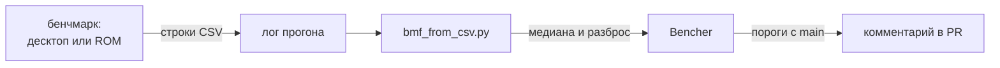

Две недели Mega Drive простояла на краю ремонтного стола: под неё пришлось дописывать стандартную библиотеку. Я пишу ToyGine2, движок для небольших игр, которые должны запускаться и на современных машинах, и на ретро-технике. Цикл ушёл на строки: чтобы они собирались на Mega Drive, вели себя как стандартные, а их скорость можно было измерить.

<!-- truncate -->

[Коротко](#short) · [Mega Drive без libc](#md-libc) · [StringView против std::string_view](#string-view) · [Бенчмарки для приставок](#benchmarks) · [Цифры](#numbers) · [Что дальше](#next)

## Коротко {#short}

У `StringView` появились поиск, сравнение и подсчёт символов UTF-8, и всё это собирается на Mega Drive, для которой пришлось дописать недостающую часть libc. Сверка со `std::string_view` перебором нашла 27 расхождений и одно падение, теперь их ноль. Движок получил бенчмарки на nanobench и конвейер, который отправляет результаты в Bencher, а для приставок заложен собственный раннер бенчмарков без плавающей точки. Всё это вошло в версию 26.19.0. [Релиз лежит на GitHub](https://github.com/ToymanInteractive/toygine2/releases/tag/26.19.0).

- `CStringView` переименован в `StringView`. `toy::utf8Len()` считает символы UTF-8, а `toy::validateUtf8()` проверяет строку по таблице 3-7 стандарта Юникода.
- Обработчик ассертов возвращает `true`, когда выполнение надо остановить, как `_CrtDbgReport` у Microsoft. В тестах обработчики больше не бросают исключение из `noexcept`-функции, которое убивало весь тестовый бинарь.
- Встроенный раннер печатает результаты тестов в текстовом формате TAP 14.
- Появились `application::Version` со сравнением, `log::Level` с потолком `LOG_MAX_LEVEL` и `log::Metadata`, а `FixedStringStorage` и концепт `StringStorage` легли в основу будущей строки без кучи.
- Библиотека ckdl и заголовки Vulkan лежат в `thirdparty/`, а редактор попал в артефакты CI.
- Сборки macOS снова получают `-O2`, `-g` и `NDEBUG`: их молча перекрывали пустые переменные флагов.

## Mega Drive без libc {#md-libc}

Сборка Mega Drive в CI упала на `#include <cstring>`. Заголовок из ClownMDSDK, набора для разработки под эту приставку, не компилировался вообще: в нём стояло `using memcpy;` без квалификации. Обойти его вызовом `::strncpy` тоже не вышло: `strncpy` в SDK не было вовсе — ни объявления, ни реализации.

Дальше выяснилось, что `libc.a` в SDK — заглушка на 1 824 байта. В ней ровно три функции: `memcpy`, `memmove` и `memset`, то есть те, вызовы которых GCC генерирует сам. Не было `memcmp`, `memchr` и `strlen`, на которые опирается `std::char_traits<char>`, а за ним и весь `StringView`.

Решение я положил в репозиторий движка, поверх установленного SDK. Это оверлей: свои `string.h` и `cstring`, которые стоят в путях поиска раньше SDK, и свой `string.c`, который компилируется в библиотеку движка. Платформенных `#ifdef` в коде не прибавилось: шов проходит по границе файлов. По map-файлу я проверил, что перекрытие работает и на линковке: `memcpy` и `strncpy` приходят из библиотеки движка, а `libc.a` загружается и не отдаёт ни одного объектного файла.

Каждую новую функцию я сверил с системной libc перебором по всем коротким строкам, длинам и значениям символа, и расхождений не нашлось. В апстриме попалась ошибка похуже недостающих функций: `cstdlib` нёс include guard от `cstring`, и после `<cstring>` заголовок `<cstdlib>` молча выпадал целиком. Правки лежат в моём форке SDK, а PR в апстрим я пока не открыл.

Одну ошибку я сделал сам: выставил оверлею `-std=gnu17` ради `asm`-вставок в `string.c`, которых там не было ни тогда, ни потом. Флаг я снял, оверлей собирается с `-std=c17`, и ROM вышел того же размера.

Набор для приставки без операционной системы обещает меньше, чем кажется по именам его заголовков: `cstring` в дереве SDK ещё не значит, что его кто-то хоть раз подключал. Для того, кто пишет игру под Mega Drive, изменилось вот что: строковые функции, на которые опирается движок, работают, и его код, написанный для десктопа, собирается там без платформенных веток.

<!--
ДЛЯ ЧЕЛОВЕКА: заглавный кадр темы про libc для Mega Drive. С первого взгляда
должно читаться, что в наборе деталей была лишь малая часть, а недостающее
докладывают своими руками. Пропорции 2:1, минимум 1200 × 630. Если генерация
не сложится, кадр можно заменить фрагментом map-файла, где функции приходят
из библиотеки движка.

ALT RU: Рядом со вскрытой 16-битной приставкой органайзер на семь ячеек: в трёх старые детали, в остальные четыре докладывают новые
ALT EN: Beside an opened 16-bit console, a seven-compartment parts organiser: three hold old parts, new parts are going into the other four

ДЛЯ AI:
On the repair bench lies a compact black 16-bit home console from the early
1990s, low and roughly square, with a rounded top, a cartridge slot in its
centre and two round push buttons beside it; its top shell is lifted off and
set aside, showing the green circuit board inside. Next to it stands a small
clear plastic parts organiser with seven compartments in a single row. The
three compartments on the left each hold a few old, slightly dull brass parts.
The other four compartments are being filled: two already hold shiny new steel
parts, one holds a single new part, and the last is still empty while the
shopkeeper's fingers drop a new steel part into it. A small paper packet of
the same new steel parts lies open beside the organiser. Seen from above at a
slight angle, the console fills the left of the frame and the organiser the
right, lit warmly from the left.

REFERENCE: draw the console exactly as in these photos:
  https://upload.wikimedia.org/wikipedia/commons/6/6a/Sega-Genesis-Mk2-6button.jpg
  (assembled),
  https://www.leadedsolder.com/assets/japanese-megadrive-va1-motherboard.jpg
  (opened). Keep its shape, proportions, colour and the layout of its slots,
  buttons and ports, redrawn in the illustration style below; leave out every
  logo, brand mark and piece of lettering the photos show.

FORMAT: 2:1 aspect ratio, at least 1200 x 630 pixels, white border included.
CAPTION: "16-bit home console, 4th generation, September 2026"

STYLE (identical across all images, so the set reads as one series):
  a hand-painted illustration in the style of Studio Ghibli films:
  watercolour-like painted backgrounds, soft cel shading, clean
  confident linework and warm diffuse shadows. It must read at once as
  a drawing, not a photograph. The illustration is presented as a
  colour print from a late 1980s or 1990s family photo album: a glossy
  paper print with a plain white border on all four sides. The image is
  the scanned print itself: the white border runs to the edges of the
  image, with no table, album page or background around it. Inside the
  border is a cosy, cluttered-but-ordered retro game shop in the spirit
  of the antique shop in Whisper of the Heart, where every object has
  its place: wooden shelves of boxed games, cartridges and cassettes,
  old consoles and home computers, a repair bench at the back. Game
  consoles, computers and media are drawn true to the shape and colour
  described in the scene above, recognisable by form alone, with no
  lettering or logos on their shells. The only writing anywhere is the CAPTION text, handwritten in
  blue ballpoint ink in small neat letters on the bottom white border,
  left of centre. Unless the scene above states otherwise, the only
  person in frame is the shopkeeper, seen from behind or as hands at
  the repair bench: a knitted cardigan over a plain shirt, sleeves
  pushed up.
PALETTE: faded warm print colours: walnut wood, beige and grey console
  plastic, creamy highlights and slightly lifted blacks, with a cool
  teal-green accent from old CRT glow; the white border slightly
  yellowed with age.
LIGHT AND TEXTURE: warm lamplight from one side, soft painted shadows,
  a gentle glow around lamps and the CRT screen, light film grain over
  the whole print, soft vignetting.
NEGATIVE: no legible text, lettering, labels or numerals inside the
  picture, including on screens, cartridges, boxes and console shells;
  no logos, brand marks or watermarks; no real brand or model names
  anywhere; no readable code on screens; no writing on the border
  other than the caption; no torn or ragged
  edges, no album page, table or background around the print; no
  photorealism or photographic rendering of the scene; no 3D render or
  CGI look; no flat vector or modern digital illustration look; no HDR
  or oversaturated colour; no neon or cyberpunk palette; no close-up
  human faces; no clutter that hides the subject.
-->

## StringView против std::string_view {#string-view}

`StringView` — вид на строку с нулевым терминатором. Он родственник `std::string_view`, но вдобавок гарантирует `c_str()`. За цикл у него появились `compare`, `starts_with` и всё семейство поиска: `find`, `rfind`, `find_first_of` и соседи, у каждого по четыре перегрузки. Поведение должно совпадать со стандартным до байта, а тесты на ручных примерах этого не доказывают.

Первую ошибку нашла красная фаза, ещё до сверки. У всех девяти перегрузок обратного поиска по умолчанию стояло `pos = 0`, а в обратном поиске `pos` ограничивает сверху позицию начала совпадения. С нулём `rfind("abra")` находил совпадение только в самом начале строки. Теперь по умолчанию стоит `npos`, как в стандарте.

Потом я написал дифференциальный харнесс: одни и те же входные данные идут в `toy::StringView` и `std::string_view`, результаты сравниваются. Так сверяют дамп картриджа: снятый ROM побайтно сравнивают с эталонным, и несовпавший байт виден сразу, без разбора, что делает игра. Первый прогон по поиску, на всех строках длиной до четырёх символов из алфавита `{a, b, c}` и на всех позициях, расхождений не дал.

Второй прогон я собрал без `_DEBUG`, то есть с выключенными ассертами, и добавил в него позиционные `compare` со счётчиками вплоть до `npos`. Он нашёл 27 расхождений и упал. Минимальный пример — `a.compare(0, npos, b, 0, npos)`: второй счётчик не ограничивался длиной, и в `memcmp` уходило `SIZE_MAX` байт. Из 27 расхождений 19 давала пятиаргументная перегрузка: при двух пустых частях и разных счётчиках она объявляла левую часть меньшей. Счётчики теперь обрезаются длиной, как в стандарте, и расхождений ноль. Прогон по остальному API под ASan и UBSan тоже чист.

Сами тесты я проверял мутациями: портил метод и смотрел, заметит ли набор. На итераторах набор поймал восемь поломок из восьми, на поиске три прошли молча. Одна из них касалась символа со старшим битом: ни один из 122 тестов не гонял его через поиск по набору. На каждую я написал свой кейс.

Харнесс проверяет ровно то, что в нём перечислено: первый прогон был чистым, потому что до `npos` в счётчиках он не доходил. Для того, кто пишет игру, поиск и сравнение в `StringView` дают те же ответы, что и стандартные, в том числе на пустых строках и на `npos`.

<!--
ДЛЯ ЧЕЛОВЕКА: кадр темы про сверку со std::string_view. С первого взгляда
должно читаться, что две записи совпадают почти целиком и расхождение одно,
отмеченное рукой. Пропорции 16:9, минимум 1600 × 900. Если генерация не
сложится, кадр можно заменить выводом харнесса с минимальным примером
расхождения.

ALT RU: Два картриджа, под каждым бумажная лента с рядами точек: ленты совпадают, кроме одной точки, обведённой красным и подсвеченной лупой
ALT EN: Two cartridges under a magnifier, each above a paper strip of dot rows; the strips match except one dot circled in red

ДЛЯ AI:
Two identical grey game cartridges lie side by side at the top of the repair
bench, seen from directly above. Below each cartridge runs a long strip of
paper, the two strips laid exactly parallel, each printed with neat rows of
small dark dots, abstract marks with nothing readable. Along almost their
whole length the rows of dots on the two strips match one for one. At a
single spot on the right-hand strip one dot sits out of place, and it is
circled in red pencil; the red pencil itself lies across the bottom of the
frame. A magnifying lamp on an arm leans over the strips, its ring light
centred on the circled dot, which is the clearest detail in the frame. The
shopkeeper's hand rests at the edge of the light, a finger pointing at the
circled dot.

FORMAT: 16:9 aspect ratio, at least 1600 x 900 pixels, white border included.
CAPTION: "September 2026"

STYLE (identical across all images, so the set reads as one series):
  a hand-painted illustration in the style of Studio Ghibli films:
  watercolour-like painted backgrounds, soft cel shading, clean
  confident linework and warm diffuse shadows. It must read at once as
  a drawing, not a photograph. The illustration is presented as a
  colour print from a late 1980s or 1990s family photo album: a glossy
  paper print with a plain white border on all four sides. The image is
  the scanned print itself: the white border runs to the edges of the
  image, with no table, album page or background around it. Inside the
  border is a cosy, cluttered-but-ordered retro game shop in the spirit
  of the antique shop in Whisper of the Heart, where every object has
  its place: wooden shelves of boxed games, cartridges and cassettes,
  old consoles and home computers, a repair bench at the back. Game
  consoles, computers and media are drawn true to the shape and colour
  described in the scene above, recognisable by form alone, with no
  lettering or logos on their shells. The only writing anywhere is the CAPTION text, handwritten in
  blue ballpoint ink in small neat letters on the bottom white border,
  left of centre. Unless the scene above states otherwise, the only
  person in frame is the shopkeeper, seen from behind or as hands at
  the repair bench: a knitted cardigan over a plain shirt, sleeves
  pushed up.
PALETTE: faded warm print colours: walnut wood, beige and grey console
  plastic, creamy highlights and slightly lifted blacks, with a cool
  teal-green accent from old CRT glow; the white border slightly
  yellowed with age.
LIGHT AND TEXTURE: warm lamplight from one side, soft painted shadows,
  a gentle glow around lamps and the CRT screen, light film grain over
  the whole print, soft vignetting.
NEGATIVE: no legible text, lettering, labels or numerals inside the
  picture, including on screens, cartridges, boxes and console shells;
  no logos, brand marks or watermarks; no real brand or model names
  anywhere; no readable code on screens; no writing on the border
  other than the caption; no torn or ragged
  edges, no album page, table or background around the print; no
  photorealism or photographic rendering of the scene; no 3D render or
  CGI look; no flat vector or modern digital illustration look; no HDR
  or oversaturated colour; no neon or cyberpunk palette; no close-up
  human faces; no clutter that hides the subject.
-->

## Бенчмарки для приставок {#benchmarks}

Поиск в `StringView` работал правильно, но о его скорости я не знал ничего: в каталоге `benchmarks/` не было ни одного бенчмарка. Мерить нужно было на десктопе и на приставках, а там nanobench не соберётся: ему нужны часы хоста, iostreams и плавающая точка, и ничего из этого на 68000 и ARM7 нет.

Начал я с nanobench на десктопе. Первые числа я снимал с отладочной сборки, где нет ни одного `-O`: одна и та же правка давала там ускорение в 14 раз, а в release — в 8. С тех пор правило записано: мерить только release-сборку.

Замеры сразу окупились. `find` перешёл на поиск первого символа через `traits_type::find` и ускорился с 405 до 55,7 нс. Для `rfind` я чуть не перенял стратегию libc++, которая сканирует вперёд и запоминает последнее совпадение. Кейс с иглой в конце четырёхкилобайтного текста показал цену: 4,08 нс у обратного прохода против 992 нс у libc++. Обратный проход остался, и каждую позицию я удешевил проверкой первого и последнего байта иглы.

На десктопе nanobench печатает таблицу, а раннер для приставок — строки CSV с целыми числами: тики таймера и число вызовов. Медиану и разброс считает скрипт на хосте CI, он же собирает отчёт для Bencher. Позже я ужал формат: имена кейса и строки таблицы пишутся один раз, а не в каждой эпохе. Эпох я выбрал 7, а не 11, и не по статистике: строка отладочного лога mGBA обрезается на 256 байтах, и при 11 эпохах худшая строка не помещается.

Часы на приставках разные. На GBA это Timer 2 без делителя, каскадом в Timer 3, чтобы 16-битный счётчик не переполнялся внутри эпохи. На Mega Drive — счётчик кадров плюс счётчик строк видеочипа. Барьер оптимизатора `sink = &value` не работал: AppleClang, `m68k-elf-gcc` и `arm-none-eabi-gcc` удаляли вычисление целиком. Его заменила вставка `asm volatile("" : : "r,m"(value) : "memory")`: инструкции в ней нет, но `value` передаётся входным операндом, и компилятор обязан его вычислить.

Одну странность я так и не объяснил: в четырёх сборках подряд замер `compare` менялся с 3,99 до 26,48 нс от одного только состава кейсов в бинаре, а в пятой эффект пропал. Нагрузку на процессор и выравнивание стека я исключил. Пока причина не найдена, я сравниваю числа только внутри одной таблицы одной сборки, где строка `std` служит контролем.

Таблица символов для find_*_of: сделал и откатил

Маска на 256 бит вместо повторного прохода по набору на каждом байте ускорила `find_first_of` и соседей в 3,7–4,3 раза и сделала их в 3–6 раз быстрее `std`. Проверить её на приставках было нечем, а там она дорога: на 68000 переменный сдвиг стоит 8 + 2n тактов на каждый байт. Я откатил её целиком и вернусь к ней, когда заработает раннер для приставок.

Число без условий сборки ничего не значит: отладочная сборка врёт, соседние кейсы влияют, и проверить замер можно только по строке `std` рядом. Для того, кто пишет игру, у движка появился способ узнать, во что обходится вызов, и тот же `*.benchmark.cpp` потом поедет на GBA и Mega Drive.

Заходил инженер со Спектрумом, спросил, сколько тактов уходит на поиск в строке. На десктопе я теперь знаю это в наносекундах. Такты на 68000 будут, когда раннер для приставок заработает в эмуляторе.

<!--
ДЛЯ ЧЕЛОВЕКА: кадр темы про бенчмарки. С первого взгляда должно читаться,
что на портативной приставке что-то замеряют несколько раз подряд и
записывают каждый замер. Пропорции 16:9, минимум 1600 × 900. Если генерация
не сложится, кадр можно заменить комментарием Bencher в пул-реквесте.

ALT RU: 32-битная портативная приставка рядом с механическим секундомером и листком с семью одинаковыми карандашными засечками
ALT EN: A 32-bit handheld console next to a mechanical stopwatch and a notepad with seven identical pencil tally marks

ДЛЯ AI:
A purple 32-bit handheld console from the early 2000s, wide, with the screen
between a direction pad on the left and two round buttons on the right, two
shoulder buttons on the top edge and a small grey cartridge in the slot in its
back edge, lies switched on in the middle of the repair bench, its screen
showing an abstract pattern of coloured pixel blocks. To its right lies a
chrome mechanical stopwatch with a white dial and plain tick marks, no
numerals. Below them lies a small notepad with seven identical short vertical
pencil tally marks in a single row, evenly spaced, and a pencil resting beside
the row. The shopkeeper's hand holds the stopwatch, thumb on the button. Seen
from above at a slight angle, the console, the stopwatch and the seven marks
form a loose triangle at the centre of the frame, lit warmly from the left.

REFERENCE: draw the console exactly as in this photo:
  https://upload.wikimedia.org/wikipedia/commons/0/0b/Nintendo-Game-Boy-Advance-Purple-FL.png
  (assembled). Keep its shape, proportions, colour and the layout of its
  slots, buttons and ports, redrawn in the illustration style below; leave out
  every logo, brand mark and piece of lettering the photos show.

FORMAT: 16:9 aspect ratio, at least 1600 x 900 pixels, white border included.
CAPTION: "32-bit handheld console, 6th generation, September 2026"

STYLE (identical across all images, so the set reads as one series):
  a hand-painted illustration in the style of Studio Ghibli films:
  watercolour-like painted backgrounds, soft cel shading, clean
  confident linework and warm diffuse shadows. It must read at once as
  a drawing, not a photograph. The illustration is presented as a
  colour print from a late 1980s or 1990s family photo album: a glossy
  paper print with a plain white border on all four sides. The image is
  the scanned print itself: the white border runs to the edges of the
  image, with no table, album page or background around it. Inside the
  border is a cosy, cluttered-but-ordered retro game shop in the spirit
  of the antique shop in Whisper of the Heart, where every object has
  its place: wooden shelves of boxed games, cartridges and cassettes,
  old consoles and home computers, a repair bench at the back. Game
  consoles, computers and media are drawn true to the shape and colour
  described in the scene above, recognisable by form alone, with no
  lettering or logos on their shells. The only writing anywhere is the CAPTION text, handwritten in
  blue ballpoint ink in small neat letters on the bottom white border,
  left of centre. Unless the scene above states otherwise, the only
  person in frame is the shopkeeper, seen from behind or as hands at
  the repair bench: a knitted cardigan over a plain shirt, sleeves
  pushed up.
PALETTE: faded warm print colours: walnut wood, beige and grey console
  plastic, creamy highlights and slightly lifted blacks, with a cool
  teal-green accent from old CRT glow; the white border slightly
  yellowed with age.
LIGHT AND TEXTURE: warm lamplight from one side, soft painted shadows,
  a gentle glow around lamps and the CRT screen, light film grain over
  the whole print, soft vignetting.
NEGATIVE: no legible text, lettering, labels or numerals inside the
  picture, including on screens, cartridges, boxes and console shells;
  no logos, brand marks or watermarks; no real brand or model names
  anywhere; no readable code on screens; no writing on the border
  other than the caption; no torn or ragged
  edges, no album page, table or background around the print; no
  photorealism or photographic rendering of the scene; no 3D render or
  CGI look; no flat vector or modern digital illustration look; no HDR
  or oversaturated colour; no neon or cyberpunk palette; no close-up
  human faces; no clutter that hides the subject.
-->

## Цифры {#numbers}

| Что мерил                 | Было                   | Стало                |
| ------------------------- | ---------------------- | -------------------- |
| `find(s, pos, count)`     | 405 нс                 | 55,7 нс              |
| `find(char, pos)`         | 40,4 нс                | 5,12 нс              |
| `rfind`, 103 байта        | 165,9 нс               | 43,0 нс              |
| `rfind`, 4 КБ             | 6 524 нс               | 2 110 нс             |
| CSV-отчёт полного прогона | 287 строк, 22 651 байт | 27 строк, 6 418 байт |

Время поиска я мерил на macOS, в release-сборке.

## Что дальше {#next}

Хранилище и концепт готовы, дальше на них встанет сама строка `toy::String`. Тела бенчмарков переедут на собственный `Bench`, а для GBA и Mega Drive появятся раннеры, которые запустят их в эмуляторах. Остаётся и долг: `_DEBUG` пока определяется только для MSVC, и на остальных платформах ассерты в отладочной сборке не проверяют ничего.
