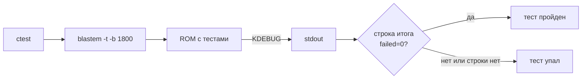

Паяльник весь цикл простоял на подставке: Mega Drive я снимал с полки не для ремонта, а ради тестов. Я пишу ToyGine2, движок для небольших игр, которые должны запускаться и на современных машинах, и на ретро-технике. В этом цикле его тесты впервые прошли на эмуляторе Mega Drive, у строки фиксированного размера появилось присваивание, а сборка перестала ходить в сеть.

<!-- truncate -->

[Коротко](#short) · [Тесты на Mega Drive и GBA](#consoles) · [Строка, которая не влезла](#string) · [Все зависимости в репозитории](#vendoring) · [Цифры](#numbers) · [Что дальше](#next)

## Коротко {#short}

Модульные тесты движка теперь гоняются в CI под эмулятором Mega Drive, а на GBA — под свободным BIOS вместо подмены, встроенной в mGBA. `toy::FixedString` получил конструкторы и присваивания по образцу `std::basic_string` и по-прежнему не трогает кучу. В сборке не осталось ни одного `FetchContent`: все зависимости лежат в репозитории. Всё это вошло в версию 26.20.0. [Релиз лежит на GitHub](https://github.com/ToymanInteractive/toygine2/releases/tag/26.20.0).

- Docker-образы тулчейнов MD и GBA собираются на нативных arm64-раннерах GitHub вместо QEMU.
- Появился образ тулчейна для N64: libdragon с ветки `preview` и GCC 16.2.
- Два тестовых бинаря движка слились в один, а раннер теперь задаётся опцией `TOYGINE_TESTS_RUNNER`.
- Бенчмарки пишутся через `toy::benchmark::Bench`: на десктопе за ним стоит nanobench, а на приставках будет встроенный раннер.
- Bencher комментирует PR только при алерте; раньше приходило семь одинаковых отчётов.
- Из `toy::` я убрал реэкспорты `std::array`, `std::char_traits`, `std::min` и ещё пяти имён: теперь они пишутся через `std::`. Это ломает обратную совместимость.

## Тесты на Mega Drive и GBA {#consoles}

На GBA тесты движка к тому времени уже месяц гонялись в CI под mGBA. Для Mega Drive я собрал эмулятор BlastEm в Docker-образ тулчейна и включил такой же прогон. Шаг CI стабильно падал по таймауту: `units-builtin ***Timeout 60.06 sec`, и ни одной строки вывода.

Временный шаг в CI с `set -x` и `blastem -h` дал немного: флага `-b`, который прогоняет заданное число кадров без окна, в справке нет. Разведка ушла в локальный контейнер, где сборка ROM и прогон занимают около секунды.

Место зависания нашла лесенка по кадрам. `-b 5` выходил сразу и с нулевым кодом, `-b 60` и `-b 1800` висели до таймаута. Значит, кадры считаются и эмуляция жива, а встаёт всё там, где раннер печатает первую строку отчёта.

ROM пишет строки отчёта в отладочный регистр видеочипа, а BlastEm печатает их как `KDEBUG MESSAGE`. Перед каждой такой печатью он зовёт `init_terminal()`. Если stdin и stdout не подключены к терминалу, BlastEm закрывает стандартные потоки, форкает xterm и ждёт на FIFO, пока тот не подключится. В контейнере CI нет X-сервера, xterm не стартует, и процесс ждёт вечно, уже без stdout. Отсюда и пустой лог. Лечит всё флаг `-t`, которого в `blastem -h` тоже нет: оба флага я нашёл только в исходниках.

Когда зависание ушло, открылась вторая дыра. BlastEm всегда выходит с кодом 0, а проверки вывода у теста не было, так что после `-t` тест зеленел бы при любом числе провалов. Теперь вердикт выносится по тексту вывода.

Строку `# assertions passed=N failed=0` раннер печатает последней, поэтому одна регулярка в `PASS_REGULAR_EXPRESSION` ловит и проваленные проверки, и прогон, оборванный на середине. Я проверил её на старом ROM, где одна проверка падала: тест покраснел, CTest вернул 8 и выложил в лог весь отчёт.

На GBA в том же цикле появился полноценный BIOS. Раньше mGBA подменял его своей эмуляцией, теперь в образе лежит emibios — свободная замена оригинальному BIOS. Первый прогон с ним вывалил в лог 192 строки `GBA DMA` от заставки. Флаг `-C skipBios=1` пропускает заставку, а системные вызовы по-прежнему идут через код BIOS. Цена: загрузка через BIOS в CI больше не проверяется.

Первые гипотезы: мёртвый 68000 и битый заголовок картриджа

Пока лог был пустым, я подозревал сам ROM: что процессор не стартует или заголовок картриджа собран неправильно. Флаг `-l` должен был записать трассу адресов, но файл оставался пустым: процесс убивали раньше, чем он успевал сбросить буфер. Обе гипотезы сняла лесенка по кадрам. Мёртвый процессор не дожил бы до выхода на пятом кадре.

Эмулятор в CI — такая же зависимость, как компилятор, и поведение BlastEm без терминала нигде не описано. Коду возврата эмулятора я не верю, пока не увижу, как тест падает. Для того, кто пишет игру на движке, изменилось вот что: CI на каждом PR прогоняет 65 кейсов и 391 проверку на эмулированных 68000 и ARM7, и ошибка, которая живёт только на 68000, всплывёт до мержа.

<!--
ДЛЯ ЧЕЛОВЕКА: заглавный кадр темы про тесты на Mega Drive. С первого взгляда
должно читаться, что приставка работает и выводит картинку, но рядом лежит
кабель, который так и не подключили: эмулятор ждал терминала, которого нет.
Пропорции 2:1, минимум 1200 × 630. Если генерация не сложится, кадр можно
заменить схемой прогона ctest и BlastEm из поста.

ALT RU: 16-битная приставка на ремонтном столе соединена с ЭЛТ-экраном, а рядом лежит кабель, который никуда не подключён
ALT EN: A 16-bit console on the repair bench wired to a CRT screen, with a loose cable beside it that leads nowhere

ДЛЯ AI:
A compact black 16-bit home console from the early 1990s, low and roughly
square, with a rounded top, a cartridge slot in its centre and two round push
buttons beside it, stands on the repair bench, whole and closed. A cable runs
from the console to a small CRT television on a stand beside the bench, and
the screen glows with a neat column of small green squares, an abstract
pattern with nothing readable. In the foreground, a second cable lies loose on
the bench, coiled, its plug pointing at nothing: it is not connected to the
console, the television or anything else. The loose plug is lit by a
magnifying lamp on an arm and is the clearest detail in the lower half of the
frame. Seen from a three-quarter angle slightly above, the console sits left,
the glowing screen right, the loose cable across the bottom.

REFERENCE: draw the console exactly as in this photo:
  https://upload.wikimedia.org/wikipedia/commons/6/6a/Sega-Genesis-Mk2-6button.jpg
  (assembled). Keep its shape, proportions, colour and the layout of its
  slots, buttons and ports, redrawn in the illustration style below; leave out
  every logo, brand mark and piece of lettering the photos show.

FORMAT: 2:1 aspect ratio, at least 1200 x 630 pixels, white border included.
CAPTION: "16-bit home console, 4th generation, September 2026"

STYLE (identical across all images, so the set reads as one series):
  a hand-painted illustration in the style of Studio Ghibli films:
  watercolour-like painted backgrounds, soft cel shading, clean
  confident linework and warm diffuse shadows. It must read at once as
  a drawing, not a photograph. The illustration is presented as a
  colour print from a late 1980s or 1990s family photo album: a glossy
  paper print with a plain white border on all four sides. The image is
  the scanned print itself: the white border runs to the edges of the
  image, with no table, album page or background around it. Inside the
  border is a cosy, cluttered-but-ordered retro game shop in the spirit
  of the antique shop in Whisper of the Heart, where every object has
  its place: wooden shelves of boxed games, cartridges and cassettes,
  old consoles and home computers, a repair bench at the back. Game
  consoles, computers and media are drawn true to the shape and colour
  described in the scene above, recognisable by form alone, with no
  lettering or logos on their shells. The only writing anywhere is the CAPTION text, handwritten in
  blue ballpoint ink in small neat letters on the bottom white border,
  left of centre. Unless the scene above states otherwise, the only
  person in frame is the shopkeeper, seen from behind or as hands at
  the repair bench: a knitted cardigan over a plain shirt, sleeves
  pushed up.
PALETTE: faded warm print colours: walnut wood, beige and grey console
  plastic, creamy highlights and slightly lifted blacks, with a cool
  teal-green accent from old CRT glow; the white border slightly
  yellowed with age.
LIGHT AND TEXTURE: warm lamplight from one side, soft painted shadows,
  a gentle glow around lamps and the CRT screen, light film grain over
  the whole print, soft vignetting.
NEGATIVE: no legible text, lettering, labels or numerals inside the
  picture, including on screens, cartridges, boxes and console shells;
  no logos, brand marks or watermarks; no real brand or model names
  anywhere; no readable code on screens; no writing on the border
  other than the caption; no torn or ragged
  edges, no album page, table or background around the print; no
  photorealism or photographic rendering of the scene; no 3D render or
  CGI look; no flat vector or modern digital illustration look; no HDR
  or oversaturated colour; no neon or cyberpunk palette; no close-up
  human faces; no clutter that hides the subject.
-->

## Строка, которая не влезла {#string}

`toy::FixedString<N>` — строка с буфером фиксированного размера внутри самого объекта, кучи она не трогает. За цикл у неё появились все конструкторы и присваивания из `std::basic_string`. Сразу встал вопрос, которого у стандартной строки нет: что делать, когда текст не влез. `std::string` бросает `std::length_error`, а в движке исключения выключены.

Я взял за образец гарантии стандарта, насколько их можно повторить без исключений. При `length_error` объект `std::string` просто не создаётся, частичного результата нет. Поэтому конструктор, которому не хватило места, в отладочной сборке останавливается на `assert_message`, а в релизной оставляет строку пустой. Обрезать до `capacity()` я не стал: такой полуправды у стандарта нет. С присваиванием иначе. Строка там уже жила, и отказ хранилища оставляет её прежней.

Потом я занялся ценой копии. `FixedString` по умолчанию копировал весь буфер. Для строки на 16 байт это дёшево: компилятор разворачивает копию в несколько инструкций. Для `FixedString<4096>` с восемью символами это 4 КБ лишней работы. Хранилище теперь копирует буфер целиком до порога, а выше порога — только `size() + 1` байт.

Один порог на все платформы не подошёл. Порог в 64 байта бьёт по десктопу, где clang разворачивает и 72-байтовую копию, а порог в 72 — по GBA. Поэтому у каждой платформы теперь свой `platform_config.hpp` с константой `c_inlineCopyMaxBytes`. Для консолей значения я снял с кода, который генерирует GCC: от 28 до 60 байт. Для macOS прогнал сетку замеров и взял 128. Windows, Linux и Switch пока получили 128 по оценке, без замера.

Заодно конструктор хранилища перестал обнулять буфер и теперь пишет только терминатор. На GBA `FixedString<256>` потерял `memset` при каждом создании. Это сразу аукнулось: тест хранилища сравнивал весь буфер и упал в CI в оптимизированной сборке, прочитав неинициализированный хвост. Чинить пришлось тест.

Отдельный сюрприз ждал на Mega Drive. Урезанная libstdc++ в SDK ставит `<ranges>` без внутреннего `bits/binders.h`, и конструктор от пары итераторов не собирался. Файл я положил в оверлей SDK в репозитории как есть. После `-O2` от `ranges` в коде MD и GBA остаются только вычитание указателей и `memcpy`.

Быстрый путь для коротких строк: откатил

Идея была копировать короткую строку блоком фиксированного размера. Clang слил обе ветки в один `memmove` на `max(size, block) + 1` байт, и на macOS стало медленнее: 2,6–3,0 нс вместо 1,9 нс. А GCC для ARMv4T без подсказки `std::assume_aligned` копировал буфер вызовом функции. Подключение `<memory>` ради этой подсказки увеличивало вывод препроцессора для общего заголовка ядра на 20%.

Без исключений у каждой операции должен быть явный ответ на вопрос «что остаётся после отказа», и лучше всего его берут из гарантий стандарта. Для того, кто пишет игру, `FixedString` ведёт себя как `std::string` везде, где это возможно без кучи. Исход переполнения предсказуем: строка остаётся пустой или прежней, но обрезанной не бывает никогда.

<!--
ДЛЯ ЧЕЛОВЕКА: кадр темы про строку фиксированного размера. С первого взгляда
должно читаться, что маленькое удобнее нести целиком, а у большого
переносят только занятое. Пропорции 16:9, минимум 1600 × 900. Если генерация
не сложится, кадр можно заменить графиком замеров копии FixedString.

ALT RU: Маленький футляр на четыре картриджа переносят целиком, а из большого, где заняты первые восемь ячеек, картриджи вынимают по одному
ALT EN: A small four-cartridge case is carried whole, while cartridges are lifted one by one from a large case with only its first eight slots filled

ДЛЯ AI:
Two open cartridge carrying cases lie on the shop counter, seen from
directly above. On the left, a small case with four slots, all four filled
with grey cartridges; the shopkeeper's left hand holds it by its handle, about
to lift the whole case at once. On the right, a large flat case with many
slots in neat rows; only the first eight slots of the top row hold grey
cartridges, and every other slot is empty and clearly visible. The
shopkeeper's right hand is lifting one cartridge out of the large case, and
two cartridges already taken out lie side by side on the counter next to it.
Warm lamplight from the left; both cases fill the frame, the large one
taking about two thirds of it.

FORMAT: 16:9 aspect ratio, at least 1600 x 900 pixels, white border included.
CAPTION: "September 2026"

STYLE (identical across all images, so the set reads as one series):
  a hand-painted illustration in the style of Studio Ghibli films:
  watercolour-like painted backgrounds, soft cel shading, clean
  confident linework and warm diffuse shadows. It must read at once as
  a drawing, not a photograph. The illustration is presented as a
  colour print from a late 1980s or 1990s family photo album: a glossy
  paper print with a plain white border on all four sides. The image is
  the scanned print itself: the white border runs to the edges of the
  image, with no table, album page or background around it. Inside the
  border is a cosy, cluttered-but-ordered retro game shop in the spirit
  of the antique shop in Whisper of the Heart, where every object has
  its place: wooden shelves of boxed games, cartridges and cassettes,
  old consoles and home computers, a repair bench at the back. Game
  consoles, computers and media are drawn true to the shape and colour
  described in the scene above, recognisable by form alone, with no
  lettering or logos on their shells. The only writing anywhere is the CAPTION text, handwritten in
  blue ballpoint ink in small neat letters on the bottom white border,
  left of centre. Unless the scene above states otherwise, the only
  person in frame is the shopkeeper, seen from behind or as hands at
  the repair bench: a knitted cardigan over a plain shirt, sleeves
  pushed up.
PALETTE: faded warm print colours: walnut wood, beige and grey console
  plastic, creamy highlights and slightly lifted blacks, with a cool
  teal-green accent from old CRT glow; the white border slightly
  yellowed with age.
LIGHT AND TEXTURE: warm lamplight from one side, soft painted shadows,
  a gentle glow around lamps and the CRT screen, light film grain over
  the whole print, soft vignetting.
NEGATIVE: no legible text, lettering, labels or numerals inside the
  picture, including on screens, cartridges, boxes and console shells;
  no logos, brand marks or watermarks; no real brand or model names
  anywhere; no readable code on screens; no writing on the border
  other than the caption; no torn or ragged
  edges, no album page, table or background around the print; no
  photorealism or photographic rendering of the scene; no 3D render or
  CGI look; no flat vector or modern digital illustration look; no HDR
  or oversaturated colour; no neon or cyberpunk palette; no close-up
  human faces; no clutter that hides the subject.
-->

## Все зависимости в репозитории {#vendoring}

До этого цикла CMake при конфигурации сам качал из сети doctest, volk и тему для Doxygen. Остальное уже лежало в `thirdparty/`, но каждый модуль там был устроен по-своему. Два способа сразу давали две версии правды: volk 1.4.350 попадал в сборку рядом с заголовками Vulkan 1.4.362.

Правило я перевернул. Раньше `FetchContent` был способом по умолчанию, теперь зависимости только вендорятся: копия лежит в `thirdparty/<имя>/`, рядом модуль `thirdparty/<имя>.cmake`, и все модули устроены одинаково.

В копию идёт только то, что нужно сборке. У zlib осталось 20 файлов: файловый API `gz*` не нужен движку, у которого свой слой ввода-вывода. У libpng осталось 29 файлов из 380, у doctest — 4, у темы Doxygen — 11 из 41, без GIF на 5,6 МБ. Так я годами разбирал донорские приставки: забираешь исправную плату, а корпус и блок питания остаются на полке.

Вендоренный код собирается с проектными флагами, включая `-Werror`, без глушилки `-w`. Библиотеки zlib, libpng и volk прошли так без единого предупреждения. А вот ckdl не прошёл: 13 ошибок от `-Wbad-function-cast` и `-Wassign-enum`, так что `-w` остался только у него, с причиной в комментарии.

Одна ловушка была с doctest. В тестовых целях стоял `include(doctest)` ради функции `doctest_discover_tests()` из помощника апстрима. Как только `thirdparty/` попал в путь модулей, по этому имени CMake стал находить мой новый `thirdparty/doctest.cmake`, и конфигурация упала на `Unknown CMake command "doctest_discover_tests"`. Разводить имена я не стал, а сделал модуль полной заменой: он создаёт цель и сам подключает помощник апстрима.

Вендоринг даёт сборку без сети, а урезанная копия под проектным `-Werror` ещё и заставляет решить, какой чужой код я готов читать и поддерживать. Цена тоже есть: обновлять копии теперь мне, а не `FetchContent`. Для того, кто собирает движок, главное вот что: после `git clone` конфигурация ничего не качает, а редактору движка не нужны ни сеть, ни Vulkan SDK.

<!--
ДЛЯ ЧЕЛОВЕКА: кадр темы про зависимости в репозитории. С первого взгляда
должно читаться, что из донорской приставки забирают только исправную плату,
а остальное остаётся. Пропорции 16:9, минимум 1600 × 900. Если генерация не
сложится, кадр можно заменить деревом каталога thirdparty/.

ALT RU: Из разобранной 32-битной портативной приставки вынимают плату, а пустые половинки корпуса сдвинуты к краю ремонтного стола
ALT EN: A circuit board is lifted out of a dismantled 32-bit handheld console, its empty shell halves pushed to the edge of the repair bench

ДЛЯ AI:
A dismantled purple 32-bit handheld console from the early 2000s, wide, with
the screen between a direction pad on the left and two round buttons on the
right, lies opened on the repair bench. The shopkeeper's fingers lift its
small green circuit board out by the edges, holding it up into the light of a
magnifying lamp on an arm; the board is the brightest, sharpest detail in the
frame. The two empty purple shell halves, the screen lens, the buttons and a
few tiny screws have been pushed together to the far edge of the bench, out of
the way. A small anti-static tray waits in the centre of the bench to receive
the board. Seen from above at a slight angle, warm lamplight from the left.

REFERENCE: draw the console exactly as in these photos:
  https://upload.wikimedia.org/wikipedia/commons/0/0b/Nintendo-Game-Boy-Advance-Purple-FL.png
  (assembled), https://guide-images.cdn.ifixit.com/igi/uxYhCDrQ3BsHBAYL.huge
  (opened). Keep its shape, proportions, colour and the layout of its slots,
  buttons and ports, redrawn in the illustration style below; leave out every
  logo, brand mark and piece of lettering the photos show.

FORMAT: 16:9 aspect ratio, at least 1600 x 900 pixels, white border included.
CAPTION: "32-bit handheld console, 6th generation, September 2026"

STYLE (identical across all images, so the set reads as one series):
  a hand-painted illustration in the style of Studio Ghibli films:
  watercolour-like painted backgrounds, soft cel shading, clean
  confident linework and warm diffuse shadows. It must read at once as
  a drawing, not a photograph. The illustration is presented as a
  colour print from a late 1980s or 1990s family photo album: a glossy
  paper print with a plain white border on all four sides. The image is
  the scanned print itself: the white border runs to the edges of the
  image, with no table, album page or background around it. Inside the
  border is a cosy, cluttered-but-ordered retro game shop in the spirit
  of the antique shop in Whisper of the Heart, where every object has
  its place: wooden shelves of boxed games, cartridges and cassettes,
  old consoles and home computers, a repair bench at the back. Game
  consoles, computers and media are drawn true to the shape and colour
  described in the scene above, recognisable by form alone, with no
  lettering or logos on their shells. The only writing anywhere is the CAPTION text, handwritten in
  blue ballpoint ink in small neat letters on the bottom white border,
  left of centre. Unless the scene above states otherwise, the only
  person in frame is the shopkeeper, seen from behind or as hands at
  the repair bench: a knitted cardigan over a plain shirt, sleeves
  pushed up.
PALETTE: faded warm print colours: walnut wood, beige and grey console
  plastic, creamy highlights and slightly lifted blacks, with a cool
  teal-green accent from old CRT glow; the white border slightly
  yellowed with age.
LIGHT AND TEXTURE: warm lamplight from one side, soft painted shadows,
  a gentle glow around lamps and the CRT screen, light film grain over
  the whole print, soft vignetting.
NEGATIVE: no legible text, lettering, labels or numerals inside the
  picture, including on screens, cartridges, boxes and console shells;
  no logos, brand marks or watermarks; no real brand or model names
  anywhere; no readable code on screens; no writing on the border
  other than the caption; no torn or ragged
  edges, no album page, table or background around the print; no
  photorealism or photographic rendering of the scene; no 3D render or
  CGI look; no flat vector or modern digital illustration look; no HDR
  or oversaturated colour; no neon or cyberpunk palette; no close-up
  human faces; no clutter that hides the subject.
-->

## Цифры {#numbers}

| Что мерил                                                              | Было                                                 | Стало                                               |
| ---------------------------------------------------------------------- | ---------------------------------------------------- | --------------------------------------------------- |
| Холодная сборка образа MD                                              | около 233 мин, обе архитектуры одним джобом под QEMU | 15,6 мин amd64 / 13,3 мин arm64, по джобу на каждую |
| Прогон тестов GBA под emibios                                          | 0,34 с (с заставкой BIOS)                            | 0,01 с                                              |
| `assign` из однопроходного итератора, 1024 символа                     | 550–780 нс                                           | 31–40 нс                                            |
| Копирующее конструирование, короткий текст (`construction_copy_short`) | 14–17 нс                                             | 2,1–2,7 нс                                          |

Замеры `FixedString` я снимал на macOS.

## Что дальше {#next}

Дальше бенчмарки поедут на приставки. Для MD и GBA нужны отчёт, таймер и свои раннеры, и только после этого станет видно, стоит ли переписывать поиск `find_first_of` в `StringView` на битовую маску. У образа N64 пока нет эмулятора, так что его тесты в CI не бегают. А реестр настроек в редакторе ждёт модели проекта, которая будет читать и писать манифест.
